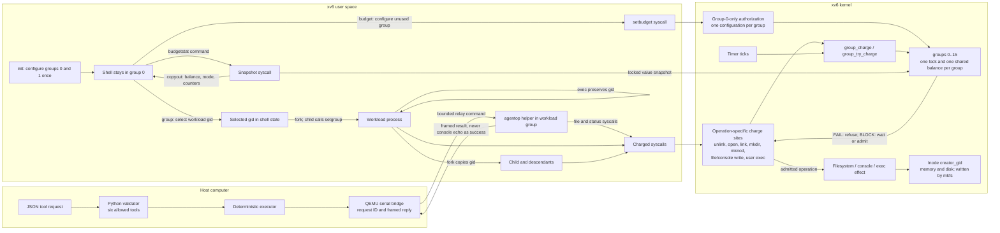
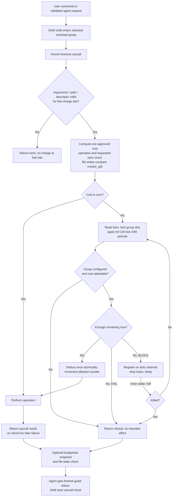

# UndoBudget presentation diagrams

These diagrams describe the implementation in this repository. GitHub renders
the Mermaid blocks directly. For slides, copy each block into a Mermaid renderer
and export it as SVG or PNG. The approved prices are engineering choices for
this project, not numbers assigned by the reference PDF.

## 1. Architecture: where each decision is made

**Present it in this order:** `init` sets the initial policy; the trusted shell
keeps gid 0 and sends each ordinary command into a configured workload group;
fork and exec cannot create a fresh balance; charge sites consult the single
locked group slot before an effect. The Python side validates requests and
reports only a verified guest result. `creator_gid` distinguishes the two
regular-file write prices. `budgetstat` exposes a read-only snapshot.

## 2. Flowchart: one positive-cost operation

**Important qualification:** `unlink` validates its target and nonempty
directory condition before charging. Its BLOCK retry releases inode locks and
the log transaction, waits, then revalidates the target and attempts the actual
charge. Other charged calls can fail after admission and keep their charge.
For file writes, the price uses the **requested** positive byte count, once per
syscall, even if a later write is partial. A zero-cost call leaves counters
unchanged. `budgetstat` reports stored balance; lazy refill happens on a charge.

### Costs to point to during the demonstration

| Operation | Cost per admitted call |
| --- | ---: |
| Unlink | 12 |
| Console write, `n > 0` | `2 + ceil(n/128)` |
| Same creator-group regular-file write, `n > 0` | `2 + ceil(n/1024)` |
| Cross creator-group regular-file write, `n > 0` | `6 + 2 × ceil(n/1024)` |
| Open with `O_CREATE`, `O_TRUNC`, or both | 4, 10, or 14 |
| `mkdir` or `mknod`; `link`; user `exec` | 6; 3; 4 |
| Everything else | 0 |

For a live walkthrough, use the exact commands in [demo.md](demo.md). A
refused `unlink` needs both its error and the surviving file to demonstrate
that the irreversible effect was prevented. For BLOCK, show a waiting command,
the timer refill, then its eventual success and changed counters.
